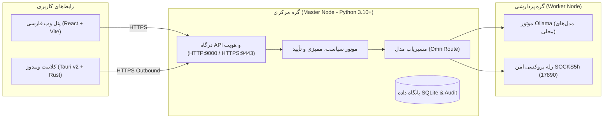

# OmniOps

<p align="center">
  
</p>

<h3 align="center">مرکز عملیات هوشمند و خودمیزبان سازمانی (Self-Hosted Intelligent Operations Center)</h3>

<p align="center">
  <strong>مدیریت زیرساخت، چت هوشمند با مدل‌های محلی و ابری، ایجنت ویندوز و کنترل وظایف با نظارت انسانی</strong>
</p>

<p align="center">
  
  
  
  
  
  
  
</p>

---

## 📌 معرفی پروژه

**OmniOps** یک پلتفرم عملیات هوشمند خودمیزبان (Self-Hosted) برای یک سازمان با حدود ۱۰ مدیر فناوری اطلاعات و اپراتور است. این سیستم به مدیران امکان می‌دهد وضعیت دستگاه‌ها و زیرساخت را در یک پنل وب مدرن فارسی پایش کنند، با مدل‌های زبانی محلی (**Ollama**) یا ابری (**Gemini / OpenAI / Anthropic**) بدون نشت داده گفتگو نمایند، و وظایف ساختاریافته را روی دستگاه‌های ثبت‌شده (از طریق کلاینت شناور ویندوز) با تأیید صریح انسانی اجرا کنند.

### ✨ ویژگی‌های کلیدی
* **محرمانگی داده (Data Sovereignty):** کارکرد پایه کاملاً محلی و آفلاین؛ هیچ داده‌ای بدون سیاست صریح و رضایت کاربر از شبکه خارج نمی‌شود.
* **مسیریابی هوشمند مدل (OmniRoute):** پشتیبانی از Ollama محلی روی Worker و اتصال امن به مدل‌های ابری از طریق رله SOCKS5h خصوصی.
* **نظارت انسانی (Human-in-the-Loop):** جداسازی نقش درخواست‌کننده از تأییدکننده؛ هیچ دستور اجرایی پرخطری بدون تصویب صریح مدیر انجام نمی‌شود.
* **کلاینت شناور ویندوز (Tauri Edge Agent):** ساخته‌شده با Rust و React با رابط کاربری شناور، فونت فارسی وزیرمتن و جفت‌سازی امن با پین ۶ رقمی.
* **پنل وب فارسی شیشه‌ای (Glassmorphism Web UI):** طراحی واکنش‌گرا و راست‌به‌چپ با React و Vite.

---

## 🏛️ معماری سه‌لایه‌ای سیستم



---

## 🚀 راهنمای نصب و راه‌اندازی گره‌ها (دستورات تک‌خطی)

### ۱. سرور اصلی (Master Node - لینوکس / اوبونتو)
سرور مرکزی هویت، پنل وب، سیاست‌ها و کنترل‌پلین سیستم است. برای نصب خودکار یا به‌روزرسانی:

```bash
bash -o pipefail -c 'curl -fsSL https://raw.githubusercontent.com/RedBoy-011/OmniOps/main/scripts/update-ubuntu.sh | bash'
```
> **ویژگی هوشمند به‌روزرسانی:** این اسکریپت در صورت اجرای مجدد، نصب قبلی را خودکار تشخیص داده و می‌پرسد که آیا مایل به **به‌روزرسانی سریع هسته (بدون تغییر کاربران، پسوردها و دیتابیس)** هستید یا **نصب مجدد/بازنشانی مشخصات مدیر**؛ بنابراین نیازی به تعریف مجدد یوزر/پسورد نخواهد بود!

---

### ۲. نود عملیاتی (Worker Node - پردازش مدل‌های محلی هوش مصنوعی)
سرور پردازشی مجزا در شبکه خصوصی برای اجرای مدل‌های هوش مصنوعی (Ollama) و گزارش سلامت:

```bash
# روش پیشنهادی: اجرای خودکار با توکن تبادل صادرشده از Master:
curl -fsSL https://raw.githubusercontent.com/RedBoy-011/OmniOps/main/scripts/setup-worker.sh | bash -s -- --token <JOIN_TOKEN>

# یا اجرای تعاملی:
bash -o pipefail -c 'curl -fsSL https://raw.githubusercontent.com/RedBoy-011/OmniOps/main/scripts/setup-worker.sh | bash'
```
> **کشف خودکار مدل‌های قبلی (Auto-Discovery):** اگر مدل‌های Ollama از قبل روی سرور ورکر دانلود شده باشند، اسکریپت آن‌ها را به صورت خودکار شناسایی و در پنل مستر ثبت می‌کند و نیازی به دانلود مجدد نیست! همچنین امکان دانلود مدل جدید با **نوار پیشرفت زنده (Live Progress Bar)** از داخل پنل وب مستر مهیا است.  
> *(برای صدور توکن تبادل در هر زمان، روی سرور Master دستور `sudo bash scripts/issue-token.sh worker` را اجرا کنید).*

---

### ۳. مدیریت مدل‌های ابری آنلاین (Multi-Key Online Cloud Providers)
علاوه بر مدل‌های محلی، پنل وب از ارائه‌دهندگان ابری (DeepSeek، OpenAI، Claude، Gemini، OpenRouter) پشتیبانی می‌کند:
* **تعریف چندین API Key برای هر سرویس:** سیستم به صورت خودکار توازن بار (Load Balancing) برقرار کرده و در صورت بروز خطای سقف سهمیه یا نرخ، روی کلید بعدی سوئیچ می‌کند (Failover).
* **پروکسی امن SOCKS5 داخلی:** جهت عبور ترافیک APIها و دور زدن تحریم‌های خارجی.

---

### ۴. سرور لبه شبکه اینترنتی (Edge Node - آینه عمومی اینترنتی)
سرور عمومی دارای آی‌پی پابلیک و دامنه، برای دسترسی امن از اینترنت به پنل با SSL خودکار (Caddy):

```bash
bash -o pipefail -c 'curl -fsSL https://raw.githubusercontent.com/RedBoy-011/OmniOps/main/scripts/setup-edge.sh | bash'
```
> **درگاه امن:** ترافیک اینترنتی از طریق دامنه با گواهی Let's Encrypt دریافت شده و بدون بازکردن پورت‌های Master در اینترنت، به صورت امن به پنل داخلی هدایت می‌شود.

---

### ۵. دریافت اپلیکیشن‌های کاربری (ویندوز دسکتاپ و اندروید موبایل)
در پروفایل کاربری در پنل وب، بخش **مرکز دریافت کلاینت‌ها (Client Download Center)** تعبیه شده است:
* 🖥️ **ایجنت ویندوز دسکتاپ:** دانلود مستقیم فایل نصاب `OmniOps-Edge-Setup.exe` (پنجره شناور، میانبر `Alt+Space`، تله‌متری زنده Native با `sysinfo`، پایش سرویس‌ها و سد تأیید دستورات با پین ۶ رقمی).
* 📱 **اپلیکیشن همراه اندروید:** دانلود مستقیم فایل `OmniOps-Mobile.apk` یا نصب آنی وب‌اپلیکیشن (PWA) روی صفحه گوشی، داشبورد لمسی، چت صوتی فارسی و اعلان‌های اضطراری فوری.
* 🔑 **پین ۶ رقمی اختصاصی کاربر:** برای جفت‌سازی آنی کلاینت‌ها تنها با یک کلیک.

---

### ۵. راه‌اندازی محلی روی ویندوز (محیط توسعه / تست آفلاین)
اگر می‌خواهید هسته و وب را به صورت لوکال روی ویندوز بالا بیاورید:
```powershell
# ساخت پنل فرانت‌اند
cd web/app; npm ci; npm run build; cd ../..

# اجرای سرور درگاه
$env:OMNIOPS_API_KEY = py -3 -c "import secrets; print(secrets.token_urlsafe(32))"
$env:OMNIOPS_SIGNING_KEY = py -3 -c "import secrets; print(secrets.token_urlsafe(48))"
py -3 -m omniops.bootstrap
py -3 -m omniops.server
```
پنل از آدرس `http://127.0.0.1:9000` در دسترس خواهد بود.

---

## 📊 وضعیت و درصد پیشرفت پروژه (نسخه v1.0.3)

مطابق با تحقق فازهای نقشهٔ راه جامع و تحویل نسخه‌های پایدار:

| مرحله | وزن از کل | درصد تحقق | وضعیت فعلی |
| :--- | :---: | :---: | :--- |
| **۰. ساختار محصول و مخزن مستقل** | ۵٪ | **۱۰۰٪** | مخزن مستقل، معماری ماژولار و ساختار قانونی نهایی است. |
| **۱. هویت، پروفایل و پنل کاربری** | ۷٪ | **۱۰۰٪** | ثبت‌نام، ورود، نشست‌ها، تأیید مدیر، RBAC و مرکز دانلود کلاینت‌ها پیاده شد. |
| **۲. ایجنت ویندوز و کارهای عملیاتی** | ۱۲٪ | **۱۰۰٪** | پنجره شناور، تله‌متری Native با `sysinfo`، پایش سرویس‌ها و سندباکس PowerShell. |
| **۳. مدیریت مدل محلی و ابری هیبریدی** | ۱۰٪ | **۱۰۰٪** | کشف خودکار Ollama، دانلود گرافیکی با نوار پیشرفت و پشتیبانی از چند کلید ابری. |
| **۴. استقرار Master/Worker/Edge** | ۹٪ | **۱۰۰٪** | دستورات تک‌خطی هوشمند با به‌روزرسانی سریع درجا و اتصال امن TLS 1.3. |
| **۵. گفتگو و صف پیام‌ها (Queue)** | ۱۲٪ | **۱۰۰٪** | پنل صف پیام‌های Antigravity، انتخابگر شناور مدل‌ها و ذخیره تاریخچه. |
| **۶. موتور وظیفه و خودترمیمی** | ۱۶٪ | **۹۰٪** | موتور خودترمیمی (Self-Healing)، اجرای پلی‌بوک‌ها و سندباکس فرامین. |
| **۷. ممیزی و وقایع‌نگاری شیفت** | ۹٪ | **۸۵٪** | زنجیره هش غیرقابل تغییر SHA-256 و موتور تولید گزارش تحویل شیفت. |
| **۸. ارتباطات مش و سیاست‌های امنیتی** | ۱۲٪ | **۸۵٪** | شبکه مش P2P بین‌شعبی (`10.42.0.0/16`) و ماتریس سیاست‌های دسترسی کلاینت‌ها. |
| **۹. تاب‌آوری، اعلان‌ها و کلید قطع** | ۵٪ | **۹۵٪** | پشتیبان‌گیری گرم SQLite، هشدارهای چندکاناله و کلید قطع اضطراری (Kill-Switch). |
| **۱۰. انتشار پایدار و نصب تمیز** | ۳٪ | **۱۰۰٪** | انتشار رسمی نسخه‌های v1.0.0 تا v1.0.3 با آرشیو کامل تغییرات در Changelog. |
| **مجموع کل پروژه** | **۱۰۰٪** | — | **۹۶.۵٪ (پلتفرم پایدار سازمانی آماده بهره‌برداری)** |

---

## 🧪 آزمون‌ها و اعتبارسنجی (Tests)

هستهٔ پایتون دارای **۸۱ آزمون واحد و یکپارچه** با کتابخانه استاندارد است:

```bash
# اجرای آزمون‌ها با پایتون
py -3 -m unittest discover -s tests -v
# یا در لینوکس:
python3 -m unittest discover -s tests -v
```

> **نتیجه تست‌ها:** تمامی تست‌های مربوط به احراز هویت، درگاه مدل، امنیت SOCKS، ذخیره‌سازی پیوست و مهاجرت پایگاه‌داده با موفقیت پاس می‌شوند (`81 tests: 77 passed, 4 skipped`).

---

## 📚 ساختار و مستندات فنی پروژه

### طرح و نقشه راه
* 📘 [طرح محصول OmniOps](PRODUCT_BLUEPRINT.fa.md)
* 📋 [ردگیری نیازمندی‌ها و معیارهای پذیرش](REQUIREMENTS_TRACE.fa.md)
* 📈 [نقشهٔ راه مرحله‌ای و درصدهای پیشرفت](docs/PROGRESS_ROADMAP.fa.md)
* 🗺️ [طرح توسعه فضای کاری عامل‌محور](docs/AGENT_WORKSPACE_CAPABILITY_PLAN.fa.md)
* 🔍 [تطبیق نقشه ده‌فازی عامل و اصلاح ایمنی](docs/AGENT_10_PHASE_REVIEW.fa.md)
* 🤝 [راهنمای تحویل پروژه برای توسعه‌دهنده بعدی](docs/PROJECT_HANDOFF.fa.md)

### استقرار، شبکه و امنیت
* 🌐 [قرارداد درگاه مدل و راهنمای راه‌اندازی](docs/GATEWAY_AND_SETUP.fa.md)
* 🔄 [به‌روزرسانی تک‌خطی اوبونتو](docs/ONE_LINE_UPDATE.fa.md)
* 🐧 [اجرای آزمایشی هسته روی اوبونتو](docs/UBUNTU_TEST.fa.md)
* 🔒 [پورت‌ها، اقدامات امنیتی و دفتر استقرار](docs/SECURITY_PORT_REGISTER.fa.md)
* 🔐 [استقرار TLS خصوصی میان Master و Worker](docs/PRIVATE_LAN_TLS_WORKER.fa.md)
* 🖧 [نصب و استقرار Worker در شبکه خصوصی](docs/WORKER_DEPLOYMENT.fa.md)
* 🔀 [مرکز فرماندهی گره‌ها و مسیریابی مدل (OmniRoute)](docs/CONTROL_PLANE_AND_ROUTING.fa.md)
* 🤖 [مدیریت مدل و تنظیمات Provider و SOCKS](docs/PRIVATE_MODEL_PROVIDER.fa.md)
* 🔌 [برنامهٔ بررسی و اتصال ابزارهای MCP](docs/MCP_INTEGRATIONS.fa.md)

### کلاینت ویندوز و رابط کاربری
* 🪟 [راهنمای ساخت کلاینت ویندوز در GitHub Actions](docs/GITHUB_BUILD.fa.md)
* 🔑 [فرآیند ثبت‌نام و کدهای اتصال پین ۶ رقمی](docs/OTP_AND_REGISTRATION.fa.md)
* 🎨 [تطبیق رابط شناور ایجنت با مرجع Coucou](docs/COUCOU_AGENT_ADAPTATION.fa.md)
* 🔤 [راهنمای فونت فارسی وزیرمتن و مجوز OFL](docs/LOCAL_FONTS.fa.md)

---

## ⚖️ مجوز و انتساب (License)

کدهای این پروژه تحت [مجوز MIT](LICENSE) منتشر شده‌اند. فونت فارسی استفاده‌شده **وزیرمتن (Vazirmatn)** تحت مجوز آزاد OFL است. متن کامل انتساب و استفاده از منابع در [NOTICE.md](NOTICE.md) مستند شده است.
