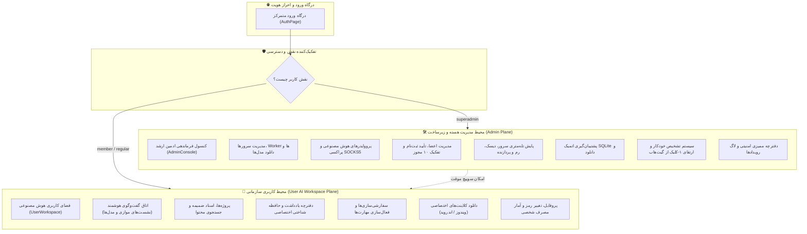
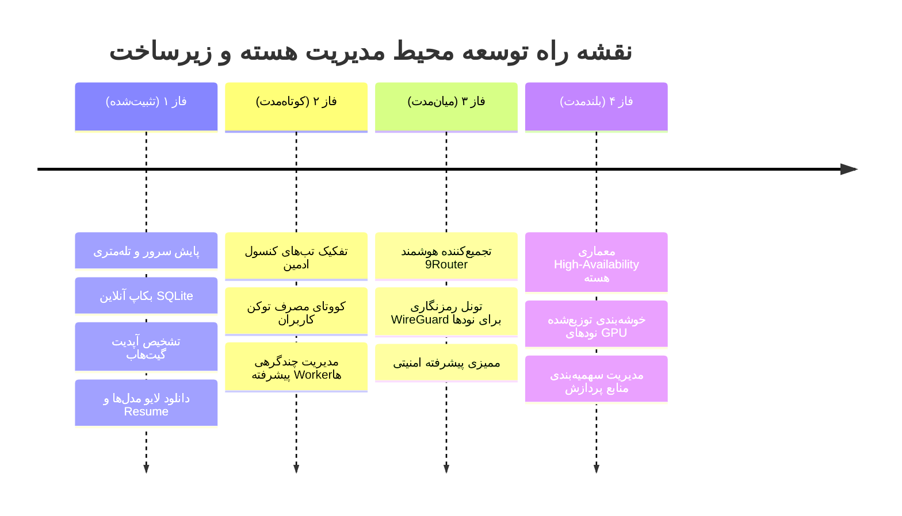
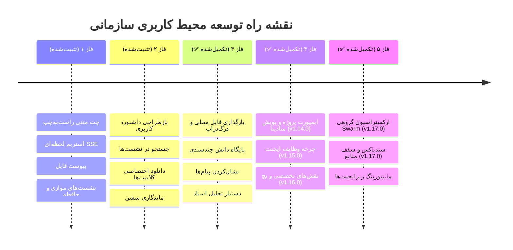

# 🗺️ نقشه راه جامع و تفکیک معماری دوگانه OmniOps (Dual-Plane Strategic Roadmap)

> **سند راهبردی و طرح تفکیک بنیادین محیط مدیریت هسته (Admin Plane) از محیط کاربری سازمانی (User Workspace Plane)**  
> **نسخه:** ۱.۰.۰ | **تاریخ تدوین:** ۱۴ اکتبر ۲۰۲۶ | **مرجع:** مخزن رسمی `RedBoy-011/OmniOps`

---

## ۱. فلسفه بنیادین تفکیک معماری دوگانه (Architectural Dual-Plane Separation)

در مقیاس سازمانی، تلفیق کنترل‌های زیرساختی سرور با فضای تعاملی کاربری، موجب افت امنیت، سردرگمی کاربر نهایی و پیچیدگی بی‌مورد تجربه کاربری می‌شود. بر این اساس، معماری سیستم به دو محیط کاملاً مستقل، با دو منطق دسترسی، تجربه بصری (UI/UX) و چرخه حیات توسعه تفکیک می‌گردد:

---

## ۲. بررسی مقایسه‌ای پیشرفت پروژه (Before vs After)

| شاخص | وضعیت قبل از تفکیک | وضعیت پس از تفکیک معماری دوگانه |
| :--- | :--- | :--- |
| **طراحی رابط کاربری (UI)** | یک صفحه پیوسته و طویل (`AdminPanel`) که همه چیز در آن اسکرول می‌شد. | دو پرتال کاملاً مجزا: **کنسول مدیریت هسته** و **فضای کاربری هوش مصنوعی**. |
| **تجربه کاربر معمولی** | کاربر معمولی اصطلاحات سرور، تله‌متری و المان‌های ناقص ادمین را می‌دید. | محیط خلوت، فوق‌العاده مدرن، متمرکز بر چت، تسک‌ها و مدیریت اسناد (مشابه ChatGPT Enterprise). |
| **تجربه ادمین ارشد** | برای دسترسی به نودها و دیتابیس باید از روی محیط چت اسکرول می‌کرد. | کنسول فرماندهی با تب‌های تفکیک‌شده و امکان سوییچ سریع ۱-کلیک به فضای کاربری. |
| **مرزهای امنیتی (Security Boundaries)** | وابستگی استعلام‌ها به مخفی‌سازی کلاینت در کنار اعتبارسنجی بک‌اند. | مسدودسازی قطعی ۱۰۰٪ در لایه API با `403 Forbidden` و تفکیک داده در لایه SQLite. |
| **پایش و نگه‌داری** | پایش منابع با نشست‌های کاربری ترکیب می‌شد. | ایزولاسیون کامل عملیات سنگین (Pull مدل، مانیتورینگ نود) از سشن‌های چت اعضا. |

---

## ۳. نقشه راه ستون اول: محیط مدیریت هسته و زیرساخت (Admin & Infrastructure Plane)

این ستون مختص **مدیران ارشد زیرساخت و فناوری اطلاعات** سازمان است. تمرکز این بخش بر ارتقای پایداری، کنترل منابع سخت‌افزاری، هوش مصنوعی توزیع‌شده و امنیت مرکزی است.

### 🔹 فازهای اجرایی ستون ادمین:

#### فاز ۱: پایش زیرساخت، نگه‌داری و پایداری (تکمیل و تثبیت‌شده ✅)
* پایش زنده تله‌متری سخت‌افزار (پردازنده، حافظه رم، فضای دیسک، سرویس‌ها).
* پشتیبان‌گیری اتمیک دیتابیس با SQLite Online Backup API بدون حتی ۱ ثانیه قطعی.
* استعلام خودکار به‌روزرسانی از گیت‌هاب و اعمال ۱-کلیک با بازسازی کلاینت وب.
* مانیتورینگ لایو دانلود مدل‌های Ollama (نرخ ۱.۵ ثانیه‌ای)، قابلیت ادامه (Resume) لایه‌ها و دکمه تلاش مجدد.

#### فاز ۲: ناوبری تب‌بندی کنسول، سهمیه‌بندی و کنترل دسترسی (تثبیت‌شده در v1.11.0 ✅)
* **تب‌بندی ساختاریافته کنسول ادمین:** تفکیک به ۶ پنل مجزا (گره‌ها و پردازش، تأمین‌کنندگان و پراکسی، کاربران و دسترسی‌ها، سلامت و پایش، پشتیبان‌گیری، دفترچه ممیزی و امنیت).
* **داشبورد بازرسی امنیتی (Security Audit Trail):** مشاهده لاگ وقایع ورود، تأیید کاربر، تغییر رمز، تغییر مدل و بکاپ با قابلیت فیلتر دسته‌بندی‌شده و جستجو (`GET /api/admin/audit`).
* **سهمیه‌بندی مصرف توکن و نرخ درخواست (Rate Limiting & Quotas):** تعیین سقف مجاز ۶۰ درخواست در ساعت برای کاربران عادی، سهمیه نامحدود برای مدیران ارشد، و کلید بازنشانی ۱-کلیک سهمیه برای ادمین (`POST /api/admin/users/reset-quota`).

#### فاز ۳: پایش میلی‌ثانیه‌ای گره‌ها و داشبورد تله‌متری منابع (تثبیت‌شده در v1.12.0 و v1.13.0 ✅)
* **تست پینگ و تأخیر ارتباطی زنده گره Worker (`GET /api/admin/nodes/ping`):** استعلام مستقیم میلی‌ثانیه‌ای RTT، نسخه نرم‌افزار Ollama و وضعیت مدل‌های مستقر با نشانگر بصری کیفیت تأخیر.
* **داشبورد تله‌متری مصرف منابع نودها (v1.13.0):** میترهای پیشرفته درصد مصرف پردازنده (CPU)، رم (RAM) و دیسک (Disk) با رنگ‌بندی آستانه خطر (سبز، زرد، قرمز).
* **فیلتر و جستجوی لحظه‌ای مدل‌های نصب‌شده گره (v1.13.0):** جستجوی درون‌خطی در میان مدل‌های هر Worker برای یافتن و مدیریت سریع مدل‌ها.
* **پایش شبکه و تونل اختصاصی Worker:** آماده‌سازی بستر برای اتصال ایمن نودهای راه‌دور به Master.
* **توزیع بار چندگرهی (Load Balancing):** برنامه‌ریزی هدایت ترافیک میان چندین کارگر.

#### فاز ۴: دسترسی‌پذیری بالا و مقیاس سازمانی (بلندمدت 🏛️)
* پیاده‌سازی مکانیزم Active-Passive Master با سنکرون‌سازی همزمان دیتابیس.
* مانیتورینگ پیشرفته مصرف VRAM کارت‌های گرافیک انویدیا با `nvidia-smi` تله‌متری.

---

## ۴. نقشه راه ستون دوم: محیط کاربری اعضا و فضای کار هوش مصنوعی (User AI Workspace Plane)

این ستون مختص **کارمندان، اپراتورها و اعضای سازمان** است. این محیط باید ساده، مدرن، فوق‌العاده سریع و عاری از هرگونه پیچیدگی فنی سرور باشد.

### 🔹 فازهای اجرایی ستون کاربری:

#### فاز ۱: پایه گفت‌وگو و ارتباط هوشمند (تکمیل و تثبیت‌شده ✅)
* اتاق گفت‌وگوی شیشه‌ای راست‌به‌چپ با تایپوگرافی وزیرمتن و استریمینگ کاراکتر-به-کاراکتر (SSE).
* نشست‌های موازی با نام‌گذاری، تغییر نام، بایگانی و پاک‌سازی تاریخچه.
* حافظه شناختی شخصی برای ثبت ترجیحات کاربر و یادآوری هوشمند در چت‌ها.
* ماندگاری کامل سشن با رفرش مرورگر (`localStorage` + ۳۰ روز اعتبار توکن) و گزینه «مرا به خاطر بسپار».

#### فاز ۲: پرتال مستقل کاربری و ارتقای ابزارهای چت (تثبیت‌شده در v1.10.0 ✅)
* **پرتال کاملاً مجزا (`UserWorkspace.tsx`):** حذف تمامی سربرگ‌ها، اصطلاحات کنترلی و المان‌های زیرساختی از دید کاربر عادی.
* **هدر اختصاصی اعضا:** نمایش خوش‌آمدگویی، مدل انتخاب‌شده، وضعیت دسترسی‌های مجاز و کلیدهای میانبر دانلود برنامه‌ها.
* **جستجوی پیشرفته در مکالمات:** امکان سرچ لحظه‌ای در تمام نشست‌های گذشته بر اساس عنوان مکالمه.
* **خروجی چندرسانه‌ای مکالمه:** دانلود متن کامل چت در قالب Markdown (`.md`) و کپی سریع در کلیپ‌بورد سیستم.
* **الگوهای پرامپت سازمانی (Corporate Prompt Templates):** شروع سریع مکالمه با قالب‌های خلاصه‌سازی، ایمیل اداری، تحلیل کد و ترجمه.
* **مرکز دانلود کلاینت‌های کاربر:** صفحه شیک و شفاف برای دانلود مستقیم نسخه ویندوز و اندروید همراه با کد اتصال اختصاصی.

#### فاز ۳: پایگاه دانش اسناد، دستیار تحلیل، چندسندی و پیام‌های برگزیده (تثبیت‌شده در v1.13.0 ✅)
* **بارگذاری مستقیم فایل‌های رایانه شخصی (Local File Upload & Drag-Drop):** بارگذاری سریع کدهای منبع، اسناد متنی، لاگ و فایل‌های داده با کشیدن و رها کردن و پیش‌نمایش محتوا قبل از ارسال.
* **پایگاه دانش چندسندی (Multi-File Knowledge Binder) (v1.13.0):** انتخاب یا درگ‌کردن همزمان تا ۵ سند با تجمیع حجم کل و تخمین هوشمند مجموع توکن‌ها، پیش‌نمایش یا حذف تفکیک‌شده و کلید حذف یکپارچه.
* **نشان‌کردن و ذخیره‌سازی پیام‌های برگزیده (Message Bookmarks) (v1.13.0):** نشان‌کردن ۱-کلیک پاسخ‌های کلیدی دستیار، فیلتر سریع پیام‌های برگزیده در سشن جاری و ذخیره‌سازی دائمی در مرورگر.
* **دستیار هوشمند تحلیل اسناد (Document Analysis Assistant):** نوار ابزار اقدامات ۱-کلیک برای خلاصه‌سازی عمیق، استخراج نکات کلیدی، پرسش و پاسخ (Q&A) و تفکیک سرفصل‌های سند.
* **تخمین زنده ابعاد سند و توکن:** محاسبه خودکار تعداد خطوط، کلمات و تخمین توکن‌های مصرفی سند قبل از ارسال به مدل.
* **مدال پیش‌نمایش متن اسناد:** امکان مشاهده و اعتبارسنجی متن استخراج‌شده فایل‌ها قبل از ارسال به مدل.
* **الگوهای پرامپت اختصاصی کاربر:** ذخیره‌سازی نامحدود پرامپت‌های کاربردی در حافظه مرورگر با دسترسی فوری.

#### فاز ۴: میز کار ایجنت، هدایت پروژه و چرخه خودکار وظایف (تثبیت‌شده در v1.14.0، v1.15.0 و v1.16.0 🚀)
* **اتصال و ایمپورت پروژه‌های نیمه‌کاره محلی (Local Project Workspace Ingestion) (v1.14.0 ✅):** اتصال به دایرکتوری پروژه‌ها روی رایانه، تشخیص خودکار فریم‌ورک‌ها (React/FastAPI/Django/Cargo/Go) و استخراج تسک‌های کشف‌شده از TODO/README.
* **تزریق ۱-کلیک کانتکست پروژه به چت هوش مصنوعی (v1.14.0 ✅):** هدایت ساختار فایل‌ها، داکیومنت‌ها و تسک‌های ناتمام به کادر پیام جهت ادامه هوشمند و عامل‌محور پروژه.
* **کاوشگر ساندباکس فایل‌ها با گارد ضد Path Traversal (v1.14.0 ✅):** مشاهده فایل‌های سورس پروژه در وب با ایمنی کامل.
* **مجری امن دستورات ترمینال در دایرکتوری پروژه با تایید انسانی (v1.14.0 ✅):** کنترل شده توسط مجوز `action.approve` یا نقش مدیر ارشد به همراه ثبت در لاگ ممیزی.
* **چرخه خودکار وظایف ایجنت (Autonomous Agent Task Loop) (v1.15.0 ✅):** تعریف اهداف و وظایف سطح بالا، تدوین خودکار پلن استراتژیک، اجرای متوالی ابزارهای ساندباکس، گیت تایید انسانی (Human-in-the-Loop) و گزارش نهایی دستاورد در وب و کلاینت ویندوز.
* **نقش‌های تخصصی ایجنت (Agent Roles: general, coder, tester, architect) (v1.16.0 ✅):** سفارشی‌سازی پلن اجرایی و لاگ‌های تله‌متری بر اساس مأموریت (عمومی، برنامه‌نویس، آزمون کیفیت، معمار سیستم).
* **موتور مقایسه، تولید و بازبینی پچ کد (Unified Diff & Patch Engine) (v1.16.0 ✅):** محاسبه اختلاف‌های خط‌به‌خط سورس‌کد با `difflib.unified_diff`، پیش‌نمایش پچ با شمارش سطرهای مثبت/منفی و اعمال با ۱ کلیک.
* **کنسول حاکمیت اداری و توقف اضطراری ایجنت‌ها (Admin Agent Governance & Kill-Switch) (v1.16.0 ✅):** پایش زنده تمام چرخه‌های ایجنت در سازمان، تایید اداری گام‌ها و کلید توقف اضطراری (Emergency Stop) تسک‌های در حال اجرا.

#### فاز ۵: ارکستراسیون گروهی ایجنت‌ها (Swarm Orchestration) و سندباکس منابع و امنیت (تثبیت‌شده در v1.17.0 🚀)
* **ارکستراسیون گروهی زیرایجنت‌های تخصصی (Hierarchical Multi-Agent Swarm Mode) (v1.17.0 ✅):** هماهنگی همزمان و متوالی ۳ زیرایجنت مستقل معمار (`architect`)، کدنویس (`coder`) و تستر (`tester`) روی پروژه، همراه با ذخیره جزئیات هر مأموریت در جدول `workspace_subagent_runs`.
* **تولید گزارش تجمیعی چندبعدی هوش مصنوعی (Swarm Synthesis Summary) (v1.17.0 ✅):** سنتز خودکار یافته‌های فنی معمار، بازرسی کدهای سورس توسط کدنویس و گزارش تست‌های تستر در یک گزارش ساختاریافته نهایی.
* **سندباکس امنیتی و سقف‌گذاری منابع محیط کار (Workspace Sandbox Guardrails & Resource Capping) (v1.17.0 ✅):** اعمال سقف زمانی تایم‌اوت (`max_timeout_seconds`)، فیلتر الگوهای مخرب ترمینال (`blocked_commands`) و فعال‌سازی اختیاری حالت سخت‌گیرانه (`strict_mode`) با وایت‌لیست پیشوندها (`allowed_prefixes`).
* **کنسول مدیریت سیاست‌های سندباکس در پنل حاکمیت اداری (v1.17.0 ✅):** تنظیمات زنده سقف تایم‌اوت و محدودیت‌های اجرایی توسط ادمین ارشد همراه با پایش وضعیت زیرایجنت‌ها در مدال بازرسی.

---

## ۵. ماتریس تفکیک دسترسی‌ها (RBAC & Security Matrix)

| قابلیت یا منبع سیستم | مدیر ارشد (`superadmin`) | کاربر عادی (`member`) | نحوه اعمال در سیستم |
| :--- | :---: | :---: | :--- |
| **ورود به کنسول مدیریت هسته (`AdminConsole`)** | ✅ بله | ❌ غیرمجاز | رندرینگ مشروط فرانت‌اند + مسدودسازی ۴۰۳ |
| **ورود به فضای کار هوش مصنوعی (`UserWorkspace`)** | ✅ بله (با سوییچ) | ✅ بله (محیط پیش‌فرض) | فعال برای هر دو نقش |
| **کنسول حاکمیت و توقف اضطراری ایجنت‌ها (`/api/admin/workspace/agent/runs*`)** | ✅ بله | ❌ غیرمجاز | تب هفتم ادمین + مسدودسازی ۴۰۳ در API |
| **پیکربندی سیاست‌های سندباکس و سقف منابع پروژه (`/api/admin/workspace/sandbox/policy`)** | ✅ بله | ❌ غیرمجاز | تب حاکمیت اداری با مسدودسازی ۴۰۳ در API |
| **میز کار هدایت پروژه محلی و پویش تسک‌ها (`AgenticWorkspace`)** | ✅ بله | ✅ بله | تب اختصاصی در محیط کاربری اعضا |
| **آغاز چرخه خودکار با نقش‌های تخصصی یا گروهی Swarm (`start_agent_run`)** | ✅ بله | ✅ بله | انتخاب نقش‌های ۴گانه یا حالت Swarm تحت سندباکس |
| **پیشنهاد و اعمال پچ کد بر روی فایل‌های پروژه (`/project/patch`)** | ✅ بله | ⚠️ نیازمند `action.request` | محاسبه Diff خط‌به‌خط + ثبت ممیزی |
| **تأیید گام‌های اجرایی ترمینال در چرخه ایجنت** | ✅ بله | ⚠️ فقط با مجوز `action.approve` | کنترل در بک‌اند و فرانت‌اند با خطای ۴۰۳ |
| **اجرای مستقیم دستورات ترمینال در پوشه پروژه (`execute_project_command`)** | ✅ بله | ⚠️ فقط با مجوز `action.approve` | کنترل در بک‌اند و فرانت‌اند با خطای ۴۰۳ |
| **سهمیه چت نامحدود و بازنشانی سهمیه کاربران** | ✅ بله | ❌ سقف ۶۰ درخواست/ساعت | اعمال در دیتابیس با خطای ۴۲۹ و اندپوینت ۴۰۳ |
| **تست پینگ و سلامت ارتباطی زنده گره Worker (`/api/admin/nodes/ping`)** | ✅ بله | ❌ غیرمجاز | روت `/api/admin/nodes/ping` با ۴۰۳ مسدود |
| **دستیار هوشمند تحلیل اسناد و تخمین توکن** | ✅ بله | ✅ بله | تعبیه شده در کادر چت هر دو محیط کاربری |
| **مشاهده دفترچه ممیزی و وقایع امنیتی (`/api/admin/audit`)** | ✅ بله | ❌ غیرمجاز | روت `/api/admin/audit` با ۴۰۳ مسدود |
| **مشاهده و دانلود مدل‌های سرور (Ollama Pull/Delete)** | ✅ بله | ❌ غیرمجاز | روت‌های `/api/admin/nodes/*` مسدود |
| **مشاهده و ذخیره کلیدهای API و تنظیم پراکسی SOCKS** | ✅ بله | ❌ غیرمجاز | روت‌های `/api/admin/providers/*` مسدود |
| **تأیید یا رد اعضای جدید و تغییر نقش کاربران** | ✅ بله | ❌ غیرمجاز | روت‌های `/api/admin/pending/*` مسدود |
| **مشاهده سلامت سرور، مصرف CPU/RAM و بکاپ دیتابیس** | ✅ بله | ❌ غیرمجاز | روت‌های `/api/admin/system/*` مسدود |
| **بررسی و اعمال به‌روزرسانی هسته از گیت‌هاب** | ✅ بله | ❌ غیرمجاز | روت‌های `/api/admin/system/update*` مسدود |
| **ارسال پیام در چت و گفت‌وگو با مدل‌های مجاز** | ✅ بله | ✅ بله (با مجوز `chat`) | کنترل شده با مجوز پروفایل |
| **بارگذاری فایل محلی و چت با اسناد پیوست** | ✅ بله | ✅ بله | فعال برای هر دو نقش با سقف ۴۸٬۰۰۰ کاراکتر |
| **پایگاه دانش چندسندی (Multi-File Binder) و نشان‌کردن پیام‌ها** | ✅ بله | ✅ بله | تعبیه شده در کادر چت هر دو محیط کاربری |
| **داشبورد تله‌متری منابع گره و جستجوی مدل‌های Worker** | ✅ بله | ❌ غیرمجاز | کارت گره‌ها در پنل ادمین با روت‌های مدیریتی |
| **مدیریت نشست‌های چت و حافظه شخصی** | ✅ بله | ✅ بله | داده‌ها در SQLite با `user_id` ایزوله هستند |
| **ویرایش مشخصات شخصی و تغییر رمز عبور** | ✅ بله | ✅ بله | روت‌های عمومی امن `/api/user/*` |
| **دریافت کلاینت‌های اختصاصی (ویندوز / اندروید)** | ✅ بله | ✅ بله | در دسترس تمامی کاربران تأییدشده |

---

## ۶. اقدامات اجرایی فوری (Action Plan)

1. **تفکیک قطعی فرانت‌اند:**
   - استخراج محیط کاربری اعضا به یک کامپوننت تمیز و مدرن به نام `UserWorkspace.tsx`.
   - ایجاد ساختار تب‌بندی‌شده و دسته‌بندی‌شده برای `AdminConsole.tsx`.
   - اضافه کردن سوئیچر دوطرفه برای ادمین در هدر (سوییچ آسان بین «کنسول ادمین» و «فضای کاری کاربر»).
2. **بررسی و تست اعتبارسنجی بک‌اند:**
   - تضمین اینکه تمام اندپوینت‌های مدیریتی با کدهای خطای واضح `403` از هرگونه نفوذ یا دسترسی کاربران عادی محافظت شده باشند.
3. **مستندسازی و ثبت در گیت:**
   - ثبت تغییرات با توضیحات رسمی در `CHANGELOG.md` و ثبت کامیت و تگ نسخه در گیت‌هاب.
